# 🇰🇷 Must-Buy Items in Korea — 짝이 있는(복수형) 물건 20

외국 초·중등 학생이 한국의 **다이소 · 편의점 · 올리브영**에서 사면 좋은 물건 20가지입니다.
영어로 **항상 복수형(-s)** 으로 쓰거나 **a pair of ~ (한 쌍/한 켤레)** 로 세는 물건 위주로 골랐어요.

## 🛒 웹 앱 (`index.html`)

`index.html`을 브라우저로 열면 20개 물건을 **그림·가격 표**로 보고, 가게별 필터·가격순 정렬을 할 수 있어요. **사진이나 이름을 누르면 그림 파일(PNG)을 저장**해요.
웹 앱의 가격은 **선물용 세트·묶음 기준 10,000~70,000원**(달러 환산 포함)으로 잡았어요.

> 💡 그림은 AI로 만든 예시 사진(`images/`), 가격은 선물용 세트·묶음 기준 **대략적인 가격**입니다. 매장·상품에 따라 달라질 수 있어요.

| No. | 그림 | 물건 (English) | 우리말 | 어디서? | 가격 (세트) | 영어로 세는 법 |
|:---:|:---:|---|---|:---:|---:|---|
| 1 | 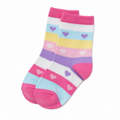 | **socks** | 캐릭터 양말 10켤레 세트 | 다이소 | 10,000원 | a pair of socks |
| 2 | 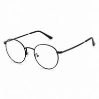 | **glasses** | 블루라이트 차단 안경 3개 | 다이소 | 15,000원 | a pair of glasses |
| 3 | 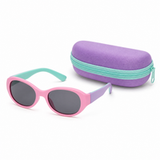 | **sunglasses** | 어린이 선글라스 + 케이스 세트 | 다이소 | 12,000원 | a pair of sunglasses |
| 4 | 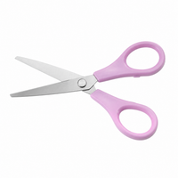 | **scissors** | 문구 가위 세트 (안전가위 포함) | 다이소 | 10,000원 | a pair of scissors |
| 5 | 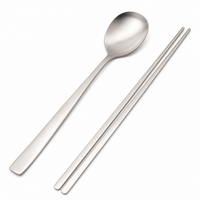 | **chopsticks** | 스테인리스 수저·젓가락 선물세트 | 다이소 | 18,000원 | a pair of chopsticks |
| 6 | 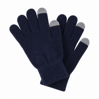 | **gloves** | 스마트폰 터치 장갑 4켤레 | 다이소 | 12,000원 | a pair of gloves |
| 7 | 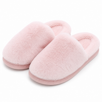 | **slippers** | 캐릭터 실내 슬리퍼 3켤레 | 다이소 | 15,000원 | a pair of slippers |
| 8 | 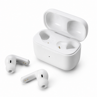 | **earphones** | 무선 블루투스 이어폰 | 편의점 | 25,000원 | a pair of earphones |
| 9 | 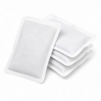 | **hand warmers** | 손난로 핫팩 20개 박스 | 편의점 | 20,000원 | a pack of hand warmers |
| 10 | 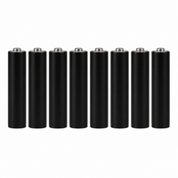 | **batteries** | AA 건전지 대용량 팩 | 편의점 | 12,000원 | a pack of batteries |
| 11 | 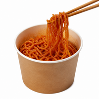 | **noodles** | 매운 볶음면 컵라면 1박스 | 편의점 | 22,000원 | a cup of noodles |
| 12 | 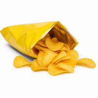 | **potato chips** | 허니버터 감자칩 묶음 | 편의점 | 15,000원 | a bag of potato chips |
| 13 | 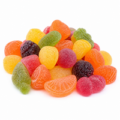 | **gummies** | 과일 젤리 10봉 묶음 | 편의점 | 18,000원 | a bag of gummies |
| 14 | 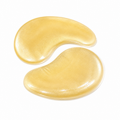 | **eye patches** | 하이드로겔 아이패치 3박스 | 올리브영 | 39,000원 | a pair of eye patches |
| 15 | 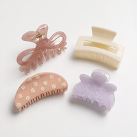 | **claw clips** | 집게핀 4종 세트 | 올리브영 | 15,000원 | a set of claw clips |
| 16 | 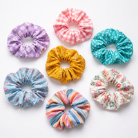 | **hair ties** | 곱창 머리끈 10개 세트 | 올리브영 | 10,000원 | a pack of hair ties |
| 17 | 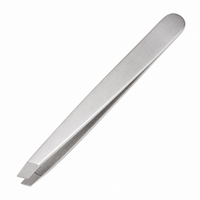 | **tweezers** | 눈썹 족집게 세트 | 올리브영 | 12,000원 | a pair of tweezers |
| 18 | 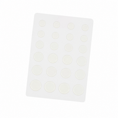 | **pimple patches** | 여드름 패치 대용량 | 올리브영 | 20,000원 | a pack of pimple patches |
| 19 | 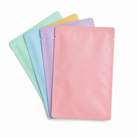 | **sheet masks** | 마스크팩 30매 박스 | 올리브영 | 45,000원 | a pack of sheet masks |
| 20 | 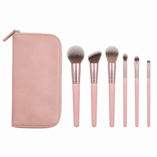 | **makeup brushes** | 메이크업 브러시 세트 (파우치 포함) | 올리브영 | 69,000원 | a set of makeup brushes |

## 📝 함께 배우기

- **둘이 한 쌍인 물건**은 늘 복수형으로 써요 → *glasses, scissors, tweezers, earphones*
  - ❌ a glass / a scissor  ✅ **a pair of** glasses / **a pair of** scissors
- 두 쌍 이상이면 *pair* 를 복수형으로! → **two pairs of** socks
- 묶음으로 파는 물건은 **a pack of / a bag of / a cup of** 로 세요.

### 🗣️ 가게에서 써 볼 문장

- *How much is **a pair of** socks?* — 양말 한 켤레에 얼마예요?
- *I want to buy **two pairs of** chopsticks.* — 젓가락 두 벌 사고 싶어요.
- *Where are the **sunglasses**?* — 선글라스는 어디 있어요?
