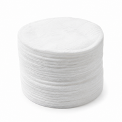
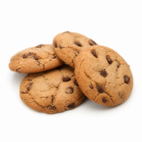
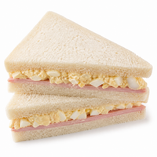

# 🇰🇷 How much are the ___? — 한국 쇼핑 물건 20

외국 초·중등 학생이 한국의 **다이소 · 올리브영 · 아트박스 · 편의점**에서 살 만한 물건 20가지입니다.
모두 **복수형(-s) 명사**라서 주요 표현에 그대로 넣어 말할 수 있어요.

> **A:** How much are the ___?  
> **B:** They're ___ won.

## 🛒 웹 앱 (`index.html`)

`index.html`을 브라우저로 열면 20개 물건을 **그림·가격 표**로 보고, 가게별 필터·가격순 정렬을 할 수 있어요.

- **사진을 누르면** 그림 파일(PNG)을 저장해요.
- **영어 단어, 주요 표현(Q/A), 가격을 누르면** 영어 발음을 들을 수 있어요. 가격은 원화만 읽어요 (예: "twelve thousand won").

> 💡 그림은 AI로 만든 예시 사진(`images/`), 가격은 선물용 세트·묶음 기준 **대략적인 가격**입니다. 매장·상품에 따라 달라질 수 있어요.

| No. | 그림 | 물건 (English) | 우리말 | 어디서? | 가격 (세트) | 주요 표현 |
|:---:|:---:|---|---|:---:|---:|---|
| 1 |  | **colored pencils** | 색연필 · 36색 세트 | 다이소 | 12,000원 | How much are the colored pencils? — They're 12,000 won. |
| 2 |  | **earmuffs** | 털 귀마개 · 2개 세트 | 다이소 | 10,000원 | How much are the earmuffs? — They're 10,000 won. |
| 3 |  | **rain boots** | 어린이 장화 | 다이소 | 15,000원 | How much are the rain boots? — They're 15,000 won. |
| 4 |  | **hairpins** | 헤어핀 · 20개 세트 | 다이소 | 10,000원 | How much are the hairpins? — They're 10,000 won. |
| 5 |  | **pajamas** | 수면 잠옷 · 상하의 세트 | 다이소 | 20,000원 | How much are the pajamas? — They're 20,000 won. |
| 6 |  | **lip tints** | 립틴트 · 3종 세트 | 올리브영 | 39,000원 | How much are the lip tints? — They're 39,000 won. |
| 7 |  | **hand creams** | 핸드크림 · 5종 세트 | 올리브영 | 25,000원 | How much are the hand creams? — They're 25,000 won. |
| 8 |  | **nail stickers** | 네일 스티커 · 3종 세트 | 올리브영 | 30,000원 | How much are the nail stickers? — They're 30,000 won. |
| 9 |  | **cotton pads** | 화장솜 · 3팩 | 올리브영 | 10,000원 | How much are the cotton pads? — They're 10,000 won. |
| 10 |  | **bath bombs** | 입욕제 · 6개 세트 | 올리브영 | 24,000원 | How much are the bath bombs? — They're 24,000 won. |
| 11 |  | **stickers** | 스티커 · 10장 팩 | 아트박스 | 12,000원 | How much are the stickers? — They're 12,000 won. |
| 12 |  | **keychains** | 인형 키링 · 3개 세트 | 아트박스 | 25,000원 | How much are the keychains? — They're 25,000 won. |
| 13 |  | **highlighters** | 형광펜 · 12색 세트 | 아트박스 | 14,000원 | How much are the highlighters? — They're 14,000 won. |
| 14 |  | **notebooks** | 스프링 노트 · 5권 | 아트박스 | 15,000원 | How much are the notebooks? — They're 15,000 won. |
| 15 |  | **stuffed animals** | 봉제 인형 · 2개 | 아트박스 | 59,000원 | How much are the stuffed animals? — They're 59,000 won. |
| 16 |  | **rice balls** | 삼각김밥 · 10개 묶음 | 편의점 | 12,000원 | How much are the rice balls? — They're 12,000 won. |
| 17 |  | **cookies** | 쿠키 · 선물 상자 | 편의점 | 15,000원 | How much are the cookies? — They're 15,000 won. |
| 18 |  | **lollipops** | 막대사탕 · 30개 통 | 편의점 | 18,000원 | How much are the lollipops? — They're 18,000 won. |
| 19 |  | **sandwiches** | 샌드위치 · 5개 | 편의점 | 16,000원 | How much are the sandwiches? — They're 16,000 won. |
| 20 |  | **chocolate bars** | 초콜릿 바 · 10개 상자 | 편의점 | 20,000원 | How much are the chocolate bars? — They're 20,000 won. |

## 📝 함께 배우기

- 물건이 **여러 개(복수)** 라서 **is** 대신 **are**, **It's** 대신 **They're** 를 써요.
  - ❌ How much **is** the stickers? ✅ How much **are** the stickers?
  - ❌ **It's** 12,000 won. ✅ **They're** 12,000 won.
- 원래 둘이 한 쌍인 물건(*earmuffs, rain boots, pajamas*)도 늘 복수형으로 써요.
